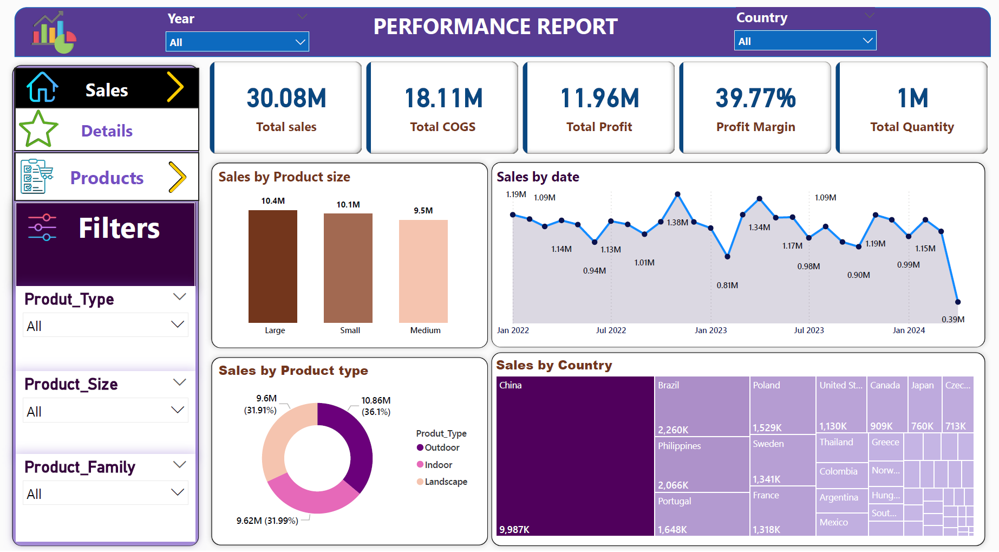
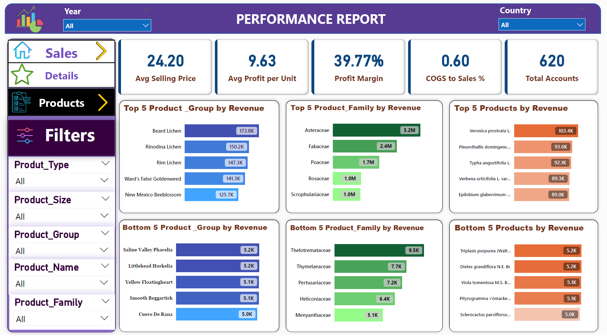
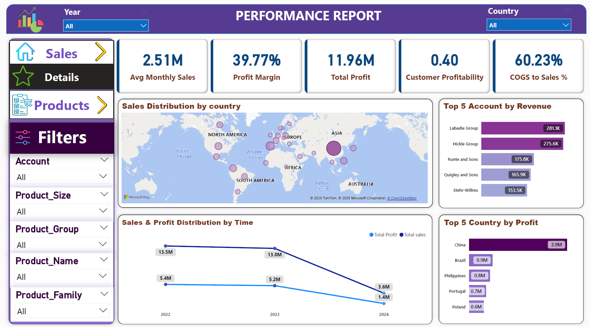

# Sales Performance Analysis

An interactive **Power BI sales analytics report** built to examine revenue, cost, profitability, product performance, customer contribution, and geographic patterns.

The repository contains the source sales data, the exported dashboard report, and dashboard screenshots.

## Dashboard Preview

### 1. Sales Overview


### 2. Products Analysis


### 3. Customer & Geographic Analysis


## Project Highlights

The report is organized into three analytical pages:

- **Sales Overview:** executive-level KPIs and sales performance trends.
- **Products Analysis:** product-level pricing, sales, and profitability comparisons, including top and bottom performers.
- **Customer & Geographic Analysis:** account contribution, geographic sales distribution, and performance trends over time.

## Dataset

The source transaction file contains **2,440 records** and **7 columns**, covering **January 1, 2022 to April 14, 2024**.

| Field | Description |
|---|---|
| `Product_id` | Product identifier |
| `Sales_USD` | Sales amount in USD |
| `quantity` | Quantity sold |
| `Price_USD` | Selling price in USD |
| `COGS_USD` | Cost of goods sold in USD |
| `Date_Time` | Transaction date |
| `Account_id` | Customer/account identifier |

The repository includes both CSV and Excel versions of the source data. The dashboard also displays product and geographic breakdowns; these attributes are not columns in the seven-field CSV and may be supplied through the report's supporting data/model.

## Key Performance Indicators

| KPI | Result |
|---|---:|
| Total Sales | **$30.08M** |
| Total COGS | **$18.11M** |
| Total Profit | **$11.96M** |
| Profit Margin | **39.77%** |
| Total Quantity | **1.24M** |
| Average Selling Price | **$24.20** |
| Average Profit per Unit | **$9.63** |

## Annual Performance

| Year | Sales | Profit | Profit Margin |
|---|---:|---:|---:|
| 2022 | $13.51M | $5.42M | 40.09% |
| 2023 | $13.00M | $5.15M | 39.62% |
| 2024* | $3.57M | $1.40M | 39.15% |

\* 2024 data is partial and ends on April 14, 2024; it should not be compared directly with the full-year totals for 2022 and 2023.

## Tools

- Microsoft Power BI
- Power Query and DAX (where implemented in the report)

## Repository Structure

```text
Sales-Performace-Analysis/
├── data/
│   ├── Plant_DTS.csv
│   └── Plant_DTS.xls
├── report/
│   └── Sales_Performance_Report.pdf
├── screenshots/
│   ├── sales-overview.png
│   ├── products-analysis.png
│   └── customer-geographic-analysis.png
└── README.md
```

## How to Explore

1. Open the PDF in `report/` to review the exported dashboard pages.
2. Open the screenshots in `screenshots/` for a quick preview.
3. Use the CSV or Excel file in `data/` to inspect the source transactions.

> The PDF is an exported report, not an interactive Power BI file. A `.pbix` file is not currently included in this repository.

## Notes & Data Interpretation

- The CSV contains 2,440 transaction rows with no missing values in its seven fields.
- There are 915 distinct product IDs and 948 distinct account IDs in the CSV.
- The 2024 reporting period is incomplete.
- Product and geographic attributes shown in the dashboard should be interpreted in the context of the report's supporting model; they are not present as fields in the core CSV.

## Author

**Mahmoud**  
GitHub: [@mahmoud7sh](https://github.com/mahmoud7sh)
